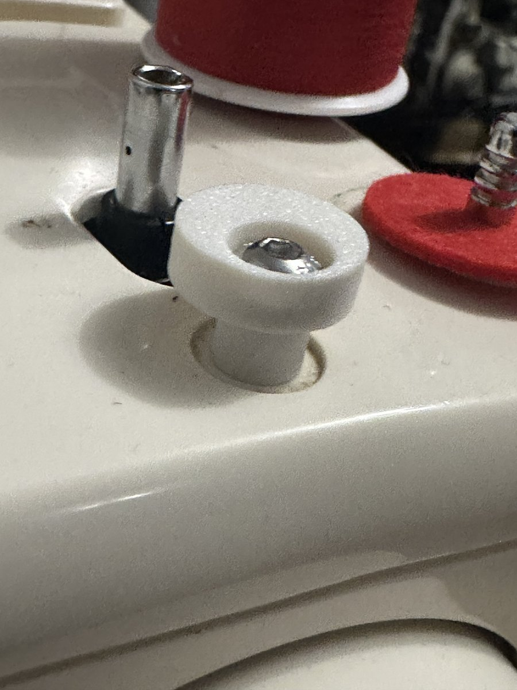
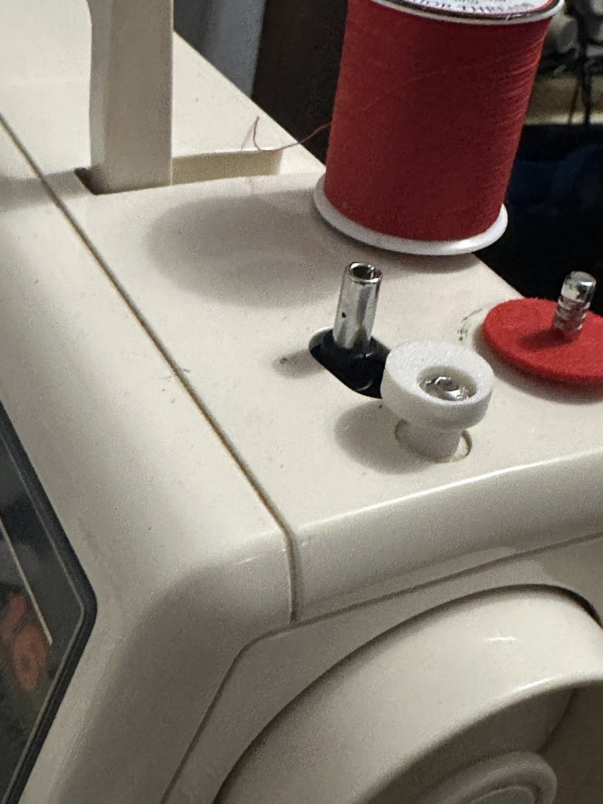
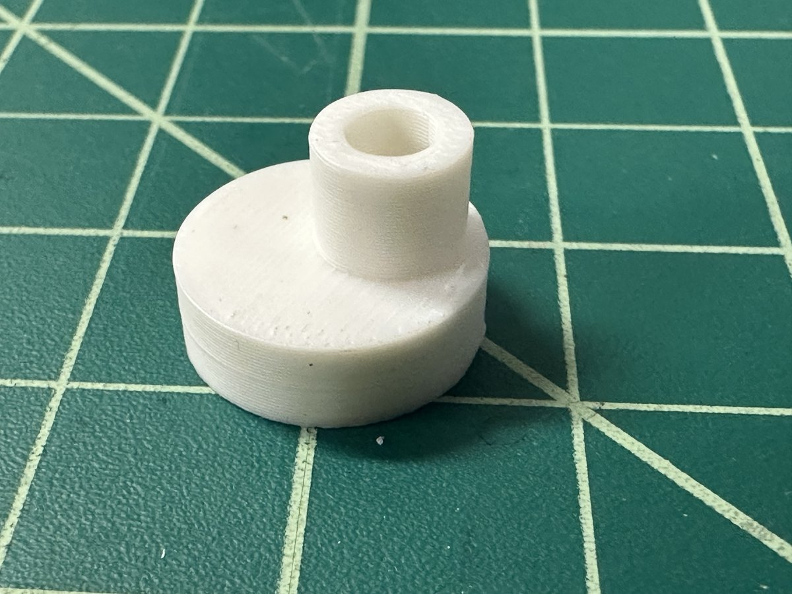
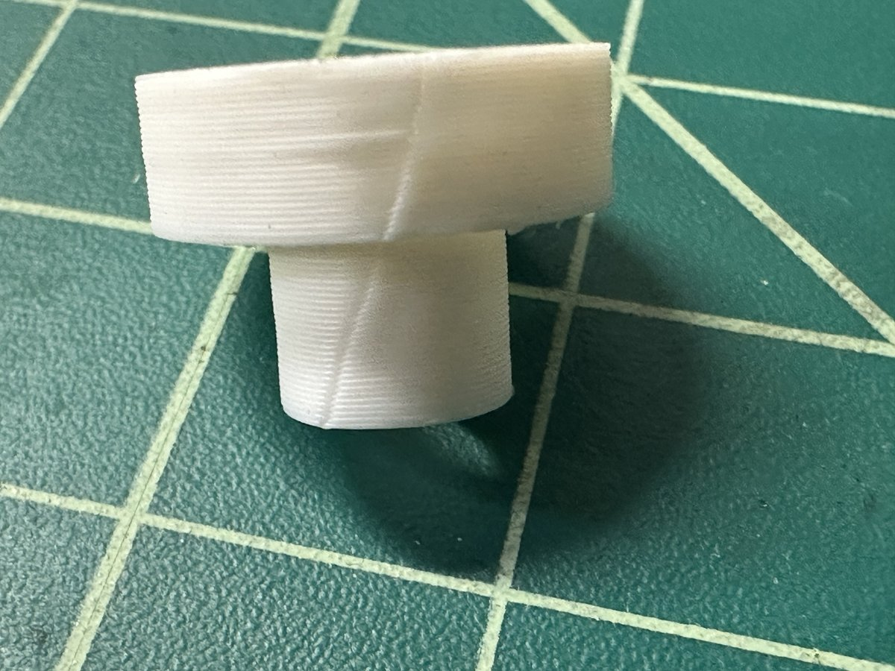
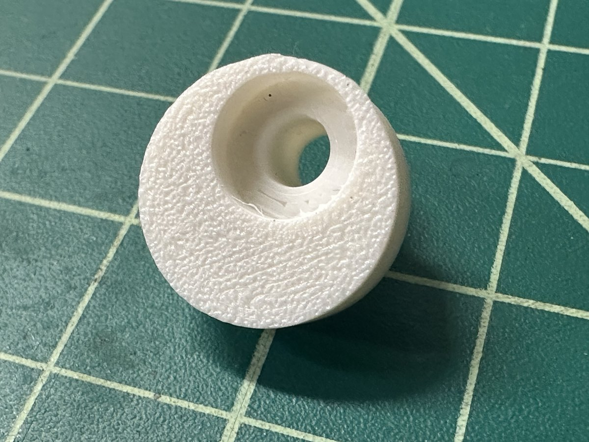
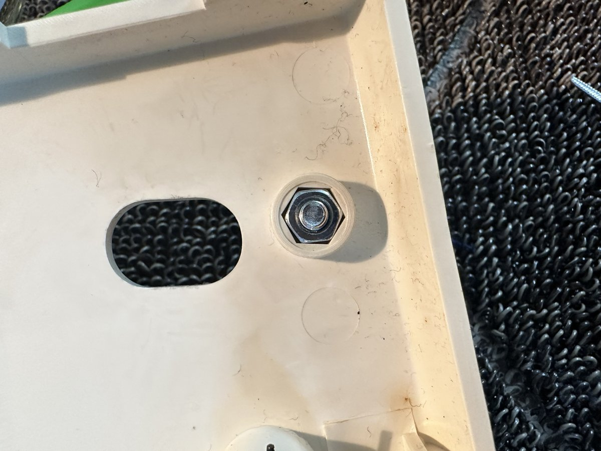

# Kenmore Bobbin Winder Stop Post

A 3D-printable replacement for the bobbin winder stop post on Kenmore
385-series sewing machines. Bob Drzyzgula designed it for a Kenmore
385.1584180 that was missing its post. The same part is common to many
contemporary Janome-built machines.

*This README and the reconstructed `bobbin_winder_post.scad` were written by
Claude (Anthropic) at Bob Drzyzgula's direction. Bob's original OpenSCAD source
was never saved, so the model was rebuilt from his exported STL and reproduces
its geometry.*

  
  

## Files

| File | Description |
|------|-------------|
| `bobbin_winder_post.scad` | Parameterized OpenSCAD model (requires [BOSL2](https://github.com/BelfrySCAD/BOSL2)) |
| `bobbin_winder_post.stl`  | Ready-to-print STL, already oriented large face down |
| `images/` | Photos of the printed part and the part installed |

## The part

The part is two round cylinders on offset axes, with an M4 socket-head
cap-screw hole running down the axis of the smaller one:

| Feature | Default |
|---------|---------|
| Post (small cylinder) | Ø7.6 mm × 5.9 mm |
| Flange (large cylinder) | Ø15.6 mm × 4.9 mm, axis offset 3.0 mm from the post |
| Overall height | 10.8 mm |
| Screw clearance hole | Ø4.5 mm (BOSL2 M4, normal fit) |
| Head counterbore | Ø8.5 mm × 2.3 mm deep, in the flange face |

  
  
  

Every dimension is a Customizer parameter, so the post can be adapted to a
machine whose original differs.

## Hardware

- One M4 socket-head cap screw, 16 mm long. The right length may vary from
  machine to machine, depending on the casting thickness where the post mounts.
- One M4 hex nut. It sits in a nut catch molded into the underside of the
  machine's plastic top cover.

## Printing

- Print with the **large (flange) face down**. The supplied STL is already
  oriented this way, and so is the `.scad` file's default output
  (`print_orientation = true`).
- It prints usably **without supports**. The flange face takes on the
  texture of the build plate, as in the photo above.
- With standard/normal supports and a support interface, a large batch in PLA
  came out clean; the supports simply tap out.

## Assembly

1. Put the screw through the part from the flange side, so the head sits in
   the counterbore.
2. Seat the post in the round socket in the top cover where the original post
   was, with the flange facing up and its offset side toward the bobbin winder
   spindle (see the installed photos).
3. From the underside of the plastic top cover, drop the M4 nut into the
   hex nut catch molded around the post hole, and tighten the screw into it.

  

## Building from source

The model uses [BOSL2](https://github.com/BelfrySCAD/BOSL2). Install it in your
OpenSCAD library folder, open `bobbin_winder_post.scad`, adjust parameters in
the Customizer if needed, then render (F6) and export.

## License

MIT. See [LICENSE](LICENSE).
